<p align="center">
  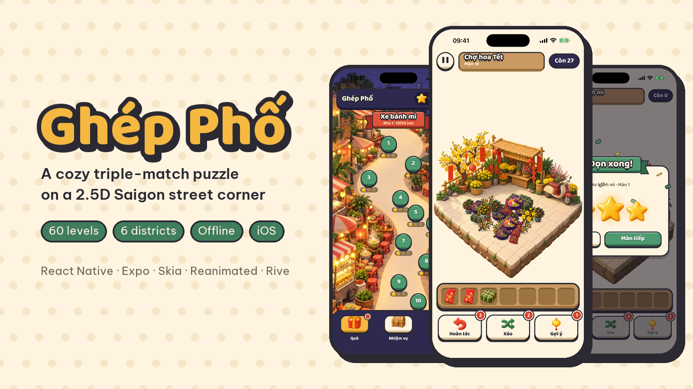
</p>

<p align="center">
  <b>A cozy triple-match puzzle on a 2.5D diorama of a Saigon street corner.</b><br>
  Portrait, one-handed, fully offline. Built with React Native, Expo, Skia, Reanimated and Rive.
</p>

<p align="center">
  <a href="README.vi.md">Tiếng Việt</a> ·
  <a href="docs/architecture.md">Architecture</a> ·
  <a href="docs/game-design.md">Game design (VI)</a>
</p>

<p align="center">
  
  
  
  
  
  
</p>

## Gameplay

<p align="center">
  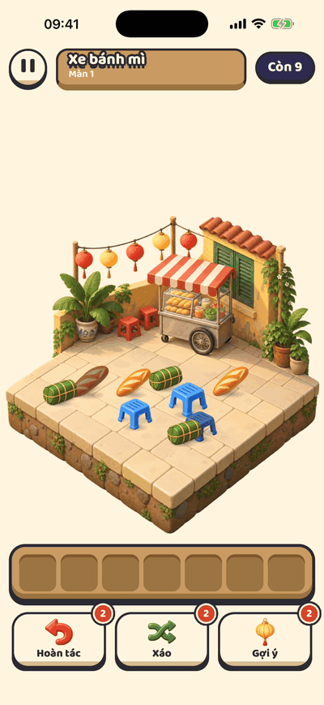
  &nbsp;
  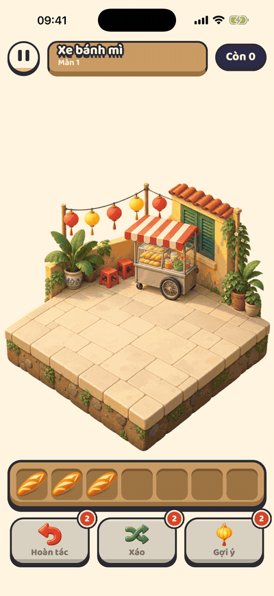
  &nbsp;
  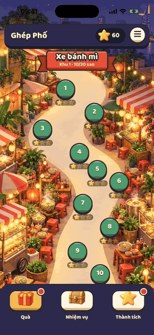
</p>

- Tap an item that nothing else covers. It lifts off the diorama, flies into the **7-slot tray** and lines up next to its kind.
- Three of a kind side by side clear from the tray. Clear the whole diorama to win.
- Fill all seven slots without a triple and the level is lost. **Undo**, **Shuffle** and **Hint** help you out, at the cost of a star.

## Screenshots

<table>
  <tr>
    <td align="center"><br><sub>District map</sub></td>
    <td align="center">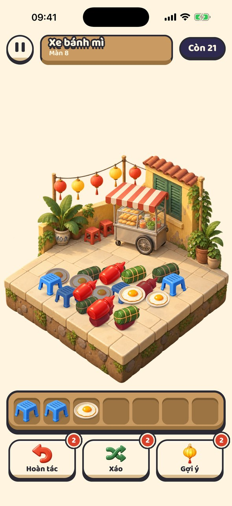<br><sub>A level in progress</sub></td>
    <td align="center">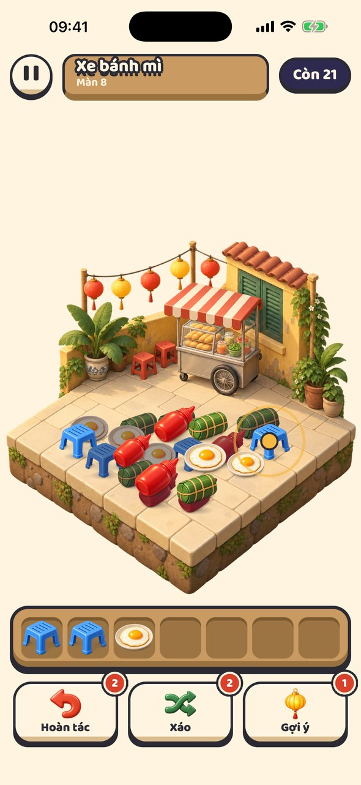<br><sub>Hint lights the next safe tap</sub></td>
  </tr>
  <tr>
    <td align="center">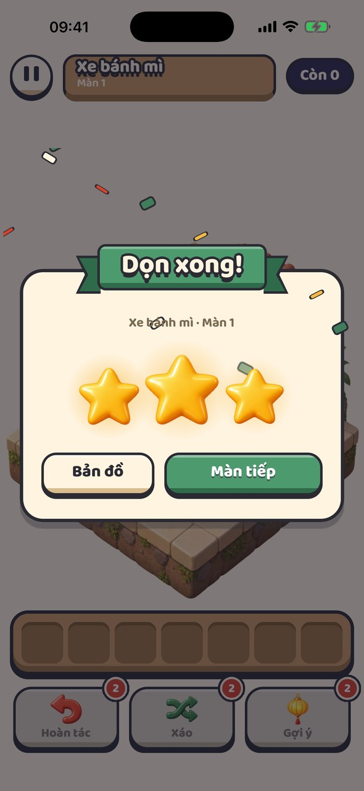<br><sub>Level cleared</sub></td>
    <td align="center">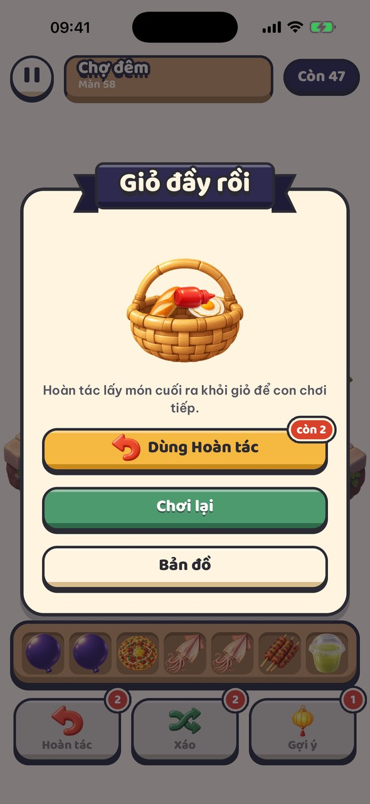<br><sub>Tray full: undo, retry or leave</sub></td>
    <td align="center">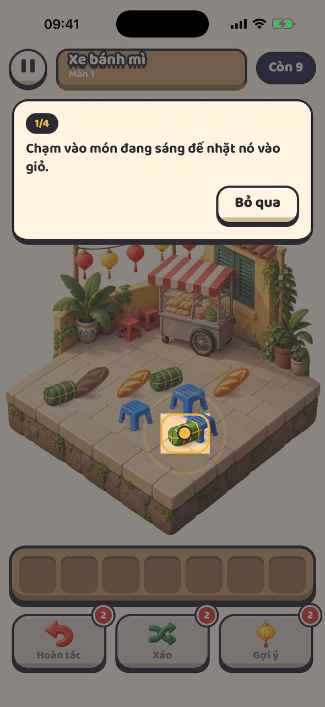<br><sub>Guided first levels</sub></td>
  </tr>
  <tr>
    <td align="center">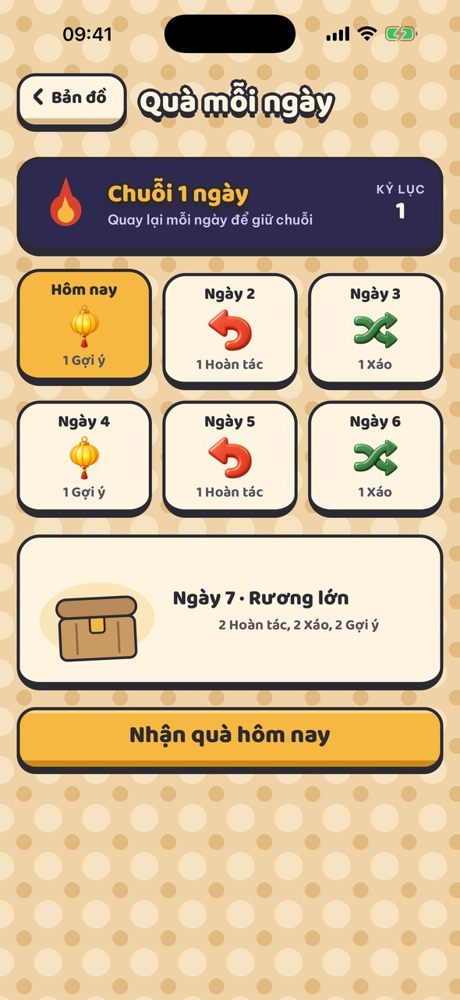<br><sub>7-day gifts and streak</sub></td>
    <td align="center">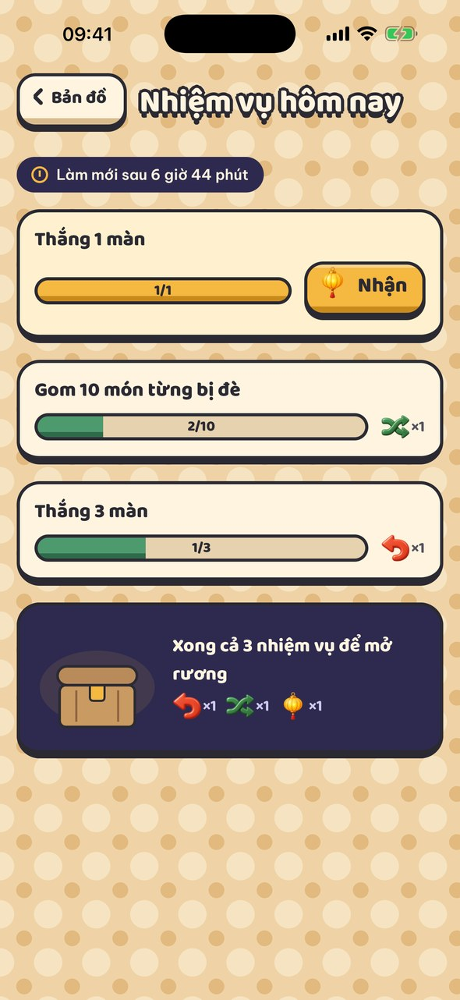<br><sub>Daily quests</sub></td>
    <td align="center">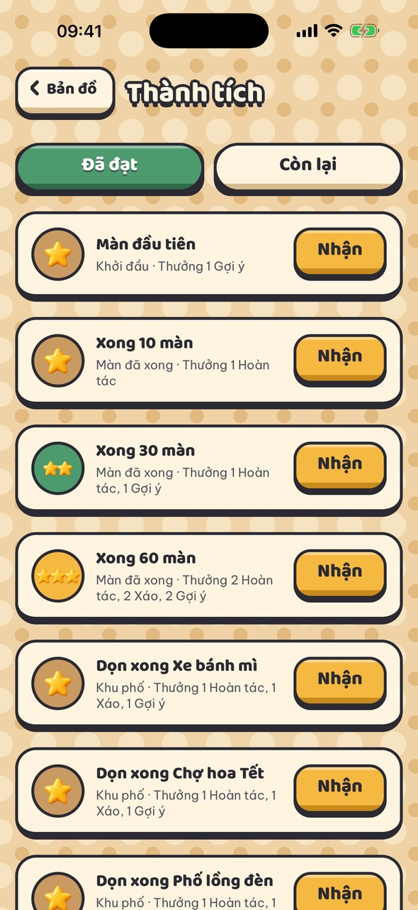<br><sub>Achievements</sub></td>
  </tr>
</table>

<details>
<summary><b>The six districts</b></summary>
<br>
<table>
  <tr>
    <td align="center"><br><sub>Xe bánh mì · bánh mì cart</sub></td>
    <td align="center">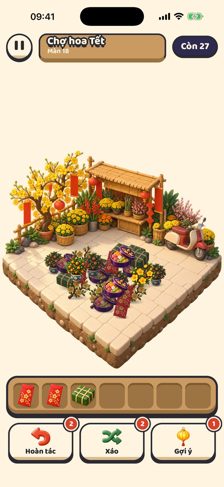<br><sub>Chợ hoa Tết · Lunar New Year flower market</sub></td>
    <td align="center">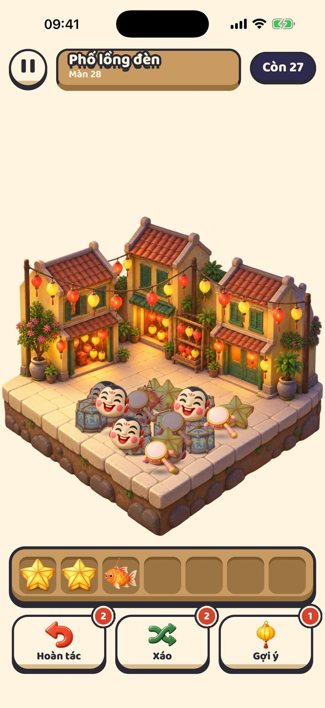<br><sub>Phố lồng đèn · lantern street</sub></td>
  </tr>
  <tr>
    <td align="center">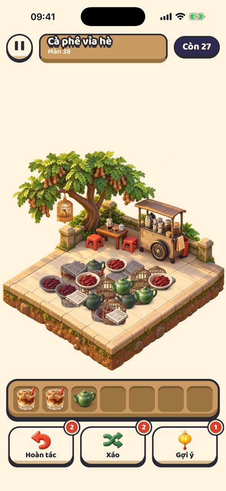<br><sub>Cà phê vỉa hè · sidewalk coffee</sub></td>
    <td align="center">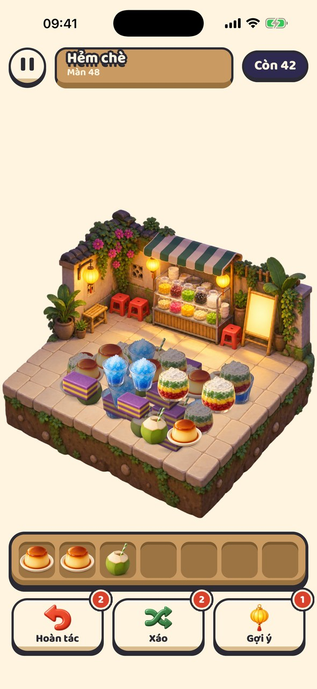<br><sub>Hẻm chè · sweet soup alley</sub></td>
    <td align="center">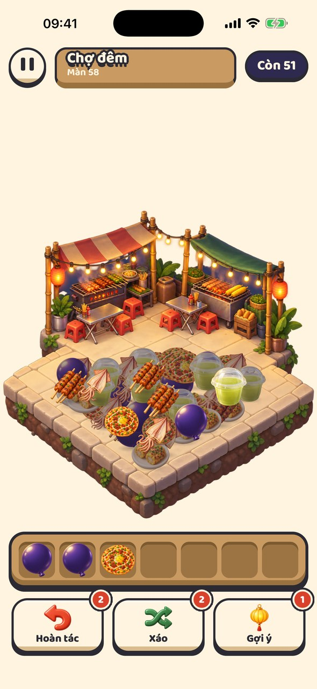<br><sub>Chợ đêm · night market</sub></td>
  </tr>
</table>
</details>

<details>
<summary><b>More screens and moments</b></summary>
<br>
<table>
  <tr>
    <td align="center">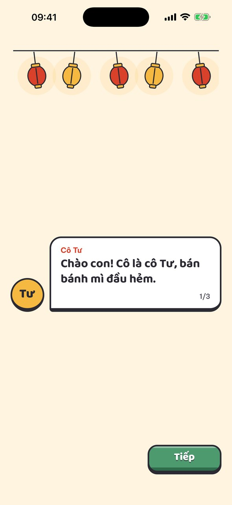<br><sub>Cô Tư says hello</sub></td>
    <td align="center">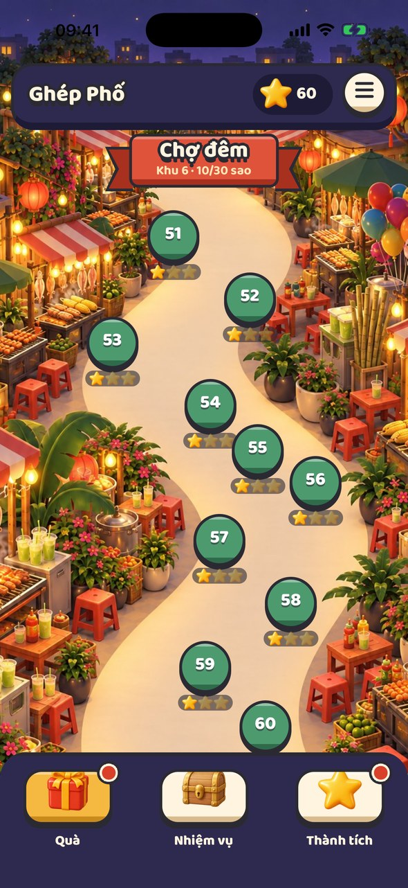<br><sub>Each district has its own map</sub></td>
    <td align="center">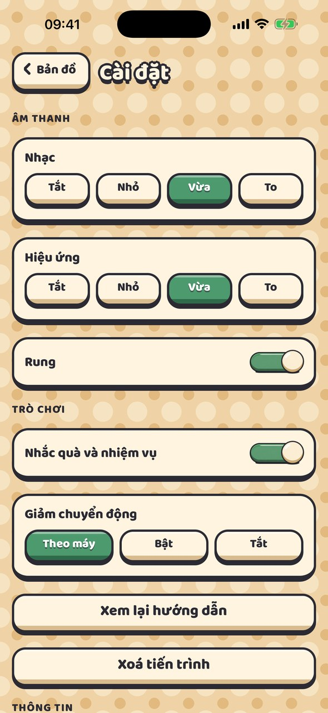<br><sub>Settings</sub></td>
  </tr>
  <tr>
    <td align="center">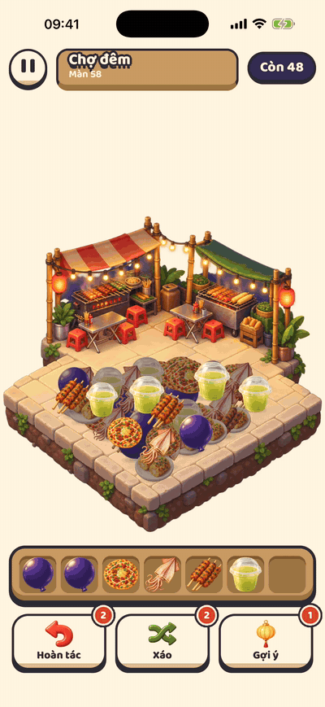<br><sub>Basket full</sub></td>
    <td align="center">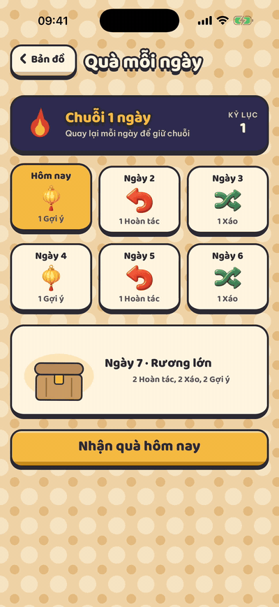<br><sub>Claiming a daily gift</sub></td>
    <td align="center">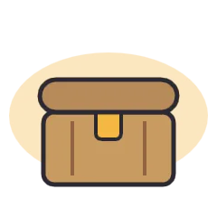<br><sub>Rive: quest chest</sub></td>
  </tr>
</table>
</details>

## Features

- **60 levels across 6 districts** of Saigon, each with its own diorama, items, map and time of day.
- **Three boosters**: Undo (also rescues a lost level), Shuffle and Hint. They are earned, never bought: no coins, no store, no ads.
- **Stars** reward clean play: three without boosters, two with one, one with more.
- **Daily loop**: 7-day login gifts with a streak, three daily quests with a chest, and achievements.
- **Guided start**: a short greeting, then lessons on levels 1 to 3 that only accept the tap being taught.
- **Feel**: hand-tuned haptics, sound effects, music, and a reduce-motion mode that follows the device or the in-game setting.
- **Offline and private**: progress lives on the device; two optional local reminders.
- **Vietnamese interface** with fonts chosen for stacked diacritics (ẫ, ặ, ỗ).

## Under the hood

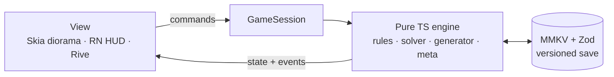

- **A pure, deterministic engine.** Everything under `src/engine/` is plain TypeScript with no React, Expo, Skia or Rive imports, enforced by lint. Randomness comes from a seeded RNG and time is passed in, so the same level and taps always give the same result. The Vitest suite (160+ tests) runs on Node without a device.
- **Generated, solver-checked levels.** A generator places items inside each district's zone along a difficulty curve, and a solver proves every level winnable before it is written. `bun run level-report` re-solves them and prints the difficulty table.
- **Pixel-accurate taps without reading pixels.** Sprite alpha is baked into coarse hit masks at build time (`scripts/make-hit-masks.ts`); hit tests and "which item covers which" run on those masks.
- **One Skia canvas, no per-frame React.** The diorama, sprites and shadows draw in a single canvas; item flights run on Reanimated shared values on the UI thread. React re-renders only on events (a tap, a landing, a cleared triple). The target is every frame under 16.7 ms, checked on Release builds in the iOS simulator.
- **Rive for the big moments.** Stars, confetti, the full basket, chests and badges come from one `.riv` file generated by a script (`design/motion/rive/generate-scene.py`), so motion is reviewable as code.
- **Versioned saves.** MMKV storage validated by Zod, with migrations between save versions.

<p align="center">
  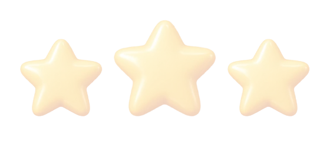
  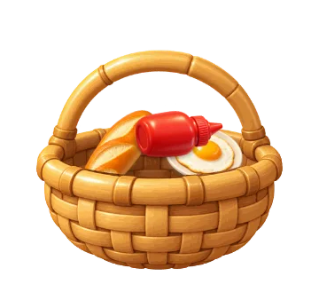
  
  
</p>

Read [docs/architecture.md](docs/architecture.md) for the layers, rules and stack details.

## Getting started

Requirements: macOS with Xcode and an iOS simulator, and [Bun](https://bun.sh). The app uses native modules (Skia, Rive, MMKV), so it runs as an Expo development build, not in Expo Go.

```bash
bun install
bunx expo prebuild --platform ios
bunx expo run:ios
```

Checks:

```bash
bun run lint && bunx tsc --noEmit && bun run test
```

Level and asset tools:

```bash
bun run levels --all                        # regenerate the 60 levels
bun run level-report src/engine/levels/data # difficulty table, re-solving every level
bun run masks assets/items/<district>       # rebuild hit masks after changing sprites
```

## Project structure

```
src/
  engine/         pure TypeScript game logic: puzzle rules, solver, generator, levels, meta, tutorial
  store/          GameSession (the one door into the engine), React context, versioned save
  scene/          the play screen: Skia diorama, tray, item flights, coach marks
  hud/            map, sheets, meta screens, settings and the UI kit
  motion/         Rive artboards
  feedback/       sound and haptics
  notifications/  local reminders
  app/            expo-router routes
scripts/          level generation, level report, hit masks
assets/           backgrounds, sprites, maps, UI art, audio, fonts
design/motion/    Rive file, the script that generates it, previews
test/             Vitest
docs/             architecture, game design, motion contract, media
```

## Credits

- Fonts: [Be Vietnam Pro](https://github.com/bettergui/BeVietnamPro) and [Baloo 2](https://github.com/EkType/Baloo2), SIL Open Font License.
- Sound effects: [Kenney](https://kenney.nl) (CC0). Music: "Slow Stride" by isaiah658 on [OpenGameArt](https://opengameart.org/content/slow-stride) (CC0). See [assets/audio/CREDITS.txt](assets/audio/CREDITS.txt).
- Art and animation: original art made for this project.

## License

The source code is released under the [MIT License](LICENSE). The game's original art, animation and screenshots are **not** covered by it: they are all rights reserved, see [ASSETS-LICENSE.md](ASSETS-LICENSE.md). Fonts and audio keep their own licenses.
