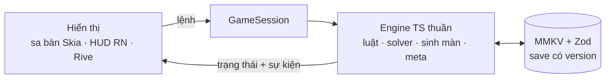

<p align="center">
  
</p>

<p align="center">
  <b>Game giải đố ghép ba nhẹ nhàng trên sa bàn 2.5D một góc phố Sài Gòn.</b><br>
  Màn dọc, chơi một tay, không cần mạng. Làm bằng React Native, Expo, Skia, Reanimated và Rive.
</p>

<p align="center">
  <a href="README.md">English</a> ·
  <a href="docs/architecture.md">Kiến trúc (EN)</a> ·
  <a href="docs/game-design.md">Luật chơi</a>
</p>

<p align="center">
  
  
  
  
  
  
</p>

## Cách chơi

<p align="center">
  
  &nbsp;&nbsp;
  
</p>

- Chạm vào một món **không bị món nào che**. Món nhấc lên, bay vào **giỏ 7 ô** và xếp cạnh món cùng loại.
- Đủ ba món giống nhau liền nhau thì bộ ba được xoá. Dọn sạch sa bàn là thắng.
- Giỏ đầy 7 ô mà không xoá được bộ nào là thua. **Hoàn tác**, **Xáo** và **Gợi ý** giúp con qua màn, đổi lại bớt một sao.

## Ảnh chụp

<table>
  <tr>
    <td align="center"><br><sub>Bản đồ khu phố</sub></td>
    <td align="center"><br><sub>Đang chơi</sub></td>
    <td align="center"><br><sub>Gợi ý chỉ món nên chạm</sub></td>
  </tr>
  <tr>
    <td align="center"><br><sub>Dọn xong màn</sub></td>
    <td align="center"><br><sub>Giỏ đầy: hoàn tác, chơi lại hay về bản đồ</sub></td>
    <td align="center"><br><sub>Hướng dẫn ở mấy màn đầu</sub></td>
  </tr>
  <tr>
    <td align="center"><br><sub>Quà 7 ngày và chuỗi ngày</sub></td>
    <td align="center"><br><sub>Nhiệm vụ mỗi ngày</sub></td>
    <td align="center"><br><sub>Thành tích</sub></td>
  </tr>
</table>

<details>
<summary><b>Sáu khu phố</b></summary>
<br>
<table>
  <tr>
    <td align="center"><br><sub>Xe bánh mì</sub></td>
    <td align="center"><br><sub>Chợ hoa Tết</sub></td>
    <td align="center"><br><sub>Phố lồng đèn</sub></td>
  </tr>
  <tr>
    <td align="center"><br><sub>Cà phê vỉa hè</sub></td>
    <td align="center"><br><sub>Hẻm chè</sub></td>
    <td align="center"><br><sub>Chợ đêm</sub></td>
  </tr>
</table>
</details>

<details>
<summary><b>Thêm màn hình và khoảnh khắc</b></summary>
<br>
<table>
  <tr>
    <td align="center"><br><sub>Cô Tư chào</sub></td>
    <td align="center"><br><sub>Mỗi khu một bản đồ riêng</sub></td>
    <td align="center"><br><sub>Cài đặt</sub></td>
  </tr>
  <tr>
    <td align="center"><br><sub>Giỏ đầy</sub></td>
    <td align="center"><br><sub>Nhận quà mỗi ngày</sub></td>
    <td align="center"><br><sub>Rive: rương nhiệm vụ</sub></td>
  </tr>
</table>
</details>

## Tính năng

- **60 màn trong 6 khu phố** Sài Gòn, mỗi khu có sa bàn, món, bản đồ và giờ trong ngày riêng.
- **Ba trợ giúp**: Hoàn tác (cứu được cả màn đã thua), Xáo và Gợi ý. Chỉ nhận qua chơi, không mua: không xu, không cửa hàng, không quảng cáo.
- **Sao** thưởng cho lối chơi gọn: ba sao khi không dùng trợ giúp, hai sao khi dùng một lần, một sao khi dùng nhiều hơn.
- **Vòng lặp mỗi ngày**: quà 7 ngày kèm chuỗi ngày, ba nhiệm vụ mỗi ngày có rương, và thành tích.
- **Bắt đầu có người dẫn**: lời chào ngắn, rồi bài dạy ở màn 1 đến 3, chỉ nhận đúng lần chạm đang dạy.
- **Cảm giác**: rung soạn tay, hiệu ứng âm thanh, nhạc nền, và chế độ giảm chuyển động theo máy hoặc theo cài đặt trong game.
- **Offline và riêng tư**: tiến trình lưu trên máy; hai lời nhắc cục bộ, tắt được.
- **Giao diện tiếng Việt**, font chọn để dấu chồng (ẫ, ặ, ỗ) không bị cắt.

## Bên trong



- **Engine thuần và tất định.** Mọi thứ trong `src/engine/` là TypeScript thuần, không import React, Expo, Skia hay Rive, lint chặn việc này. Ngẫu nhiên đi qua RNG có seed, thời gian truyền từ ngoài vào, nên cùng màn và cùng các lần chạm luôn ra cùng kết quả. Bộ test Vitest (hơn 160 test) chạy trên Node, không cần thiết bị.
- **Màn chơi sinh tự động, solver kiểm từng màn.** Bộ sinh đặt món trong vùng của mỗi khu theo đường cong độ khó, và solver chứng minh mỗi màn thắng được trước khi ghi ra. `bun run level-report` giải lại và in bảng độ khó.
- **Chạm đúng từng điểm ảnh mà không đọc điểm ảnh.** Độ trong suốt của sprite được nướng thành mặt nạ lúc build (`scripts/make-hit-masks.ts`); chạm chọn và quan hệ "món nào đè món nào" đều tính trên mặt nạ đó.
- **Một canvas Skia, không re-render React mỗi frame.** Sa bàn, sprite và bóng vẽ trong một canvas; món bay vào giỏ chạy bằng shared value của Reanimated trên UI thread. React chỉ re-render khi có sự kiện (chạm, món đáp xuống, bộ ba được xoá). Mục tiêu là mọi khung dưới 16,7 ms, kiểm trên bản Release chạy trong simulator iOS.
- **Rive cho những khoảnh khắc lớn.** Sao, confetti, giỏ đầy, rương và huy hiệu nằm trong một file `.riv` sinh bằng script (`design/motion/rive/generate-scene.py`), nên chuyển động được review như code.
- **Save có version.** Lưu bằng MMKV, kiểm bằng Zod, có migration giữa các phiên bản save.

<p align="center">
  
  
  
  
</p>

Đọc [docs/architecture.md](docs/architecture.md) (tiếng Anh) để biết các lớp, quy tắc và chi tiết stack.

## Chạy thử

Cần macOS có Xcode và simulator iOS, cùng [Bun](https://bun.sh). App dùng module native (Skia, Rive, MMKV) nên chạy bằng development build của Expo, không chạy trong Expo Go.

```bash
bun install
bunx expo prebuild --platform ios
bunx expo run:ios
```

Kiểm tra:

```bash
bun run lint && bunx tsc --noEmit && bun run test
```

Công cụ cho màn chơi và asset:

```bash
bun run levels --all                        # sinh lại 60 màn
bun run level-report src/engine/levels/data # bảng độ khó, giải lại từng màn
bun run masks assets/items/<khu>            # sinh lại mặt nạ chạm sau khi đổi sprite
```

## Cấu trúc thư mục

```
src/
  engine/         logic game TS thuần: luật, solver, sinh màn, màn chơi, meta, bài dạy
  store/          GameSession (cửa duy nhất xuống engine), React context, save có version
  scene/          màn chơi: sa bàn Skia, giỏ, món bay, khoét lỗ hướng dẫn
  hud/            bản đồ, các bảng, màn meta, cài đặt và bộ UI
  motion/         artboard Rive
  feedback/       âm thanh và rung
  notifications/  nhắc nhở cục bộ
  app/            route của expo-router
scripts/          sinh màn, báo cáo màn, mặt nạ chạm
assets/           nền, sprite, bản đồ, ảnh UI, âm thanh, font
design/motion/    file Rive, script sinh ra nó, ảnh xem trước
test/             Vitest
docs/             kiến trúc, luật chơi, hợp đồng hoạt ảnh, ảnh demo
```

## Ghi công

- Font: [Be Vietnam Pro](https://github.com/bettergui/BeVietnamPro) và [Baloo 2](https://github.com/EkType/Baloo2), giấy phép SIL Open Font License.
- Hiệu ứng âm thanh: [Kenney](https://kenney.nl) (CC0). Nhạc: "Slow Stride" của isaiah658 trên [OpenGameArt](https://opengameart.org/content/slow-stride) (CC0). Xem [assets/audio/CREDITS.txt](assets/audio/CREDITS.txt).
- Hình ảnh và hoạt ảnh: hình gốc làm riêng cho dự án này.

## Giấy phép

Mã nguồn phát hành theo [giấy phép MIT](LICENSE). Hình ảnh, hoạt ảnh và ảnh chụp gốc của game **không** thuộc giấy phép này: tác giả giữ toàn quyền, xem [ASSETS-LICENSE.md](ASSETS-LICENSE.md). Font và âm thanh giữ giấy phép riêng của chúng.
