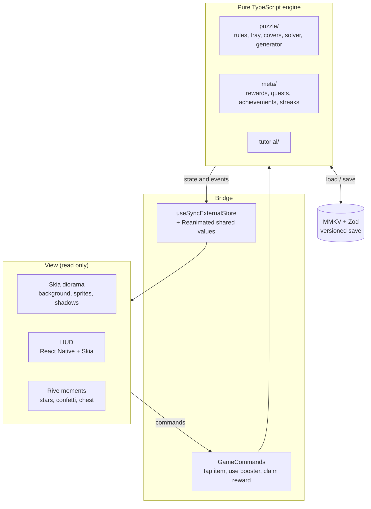

# Architecture

Ghép Phố is a portrait, one-handed, offline triple-match puzzle set on a 2.5D diorama of a Saigon street corner. It targets iOS first and is built with Expo (development build) and React Native. The interface is in Vietnamese; code, file names and identifiers are in English.

For the rules of the game see [game-design.md](game-design.md) (Vietnamese). For the Rive artboards see [motion-contract.md](motion-contract.md) (Vietnamese).

## Layers



`src/store/session.ts` (`GameSession`) is the only door into the engine. It holds the save, the level in play and the tutorial, applies commands, and publishes state to React through `useSyncExternalStore` (`src/store/GameContext.tsx`).

## Rules the code keeps

1. **The engine is the single source of truth.** The UI never changes game state on its own; every change goes through an engine function.
2. **The engine is plain TypeScript.** Nothing under `src/engine/` imports React, React Native, Expo, Skia or Rive. ESLint enforces this (`eslint.config.js`).
3. **The engine is deterministic.** `Math.random()`, `Date.now()` and `new Date()` are banned in the engine by lint. Randomness comes from the seeded RNG in `src/engine/rng.ts`, and the current time is passed in by the caller. The same level, seed and taps always give the same result, which is what makes the solver, the hints and the tests trustworthy.
4. **No `setState` per frame.** Item positions and animations live in Reanimated shared values that Skia reads on the UI thread. React re-renders only on events: a tap, an item landing in the tray, a triple clearing.
5. **The view shows no number the engine did not produce**, including the star count passed to Rive.
6. **Hit testing and occlusion use alpha masks generated at build time**, not pixel reads at runtime. `scripts/make-hit-masks.ts` turns each sprite into a coarse opacity grid stored in `assets/items/<district>/masks.json`.

## Engine

| Folder | What it holds |
| --- | --- |
| `src/engine/puzzle/` | Board coordinates and draw order (`types.ts`), item boxes (`level.ts`), mask sampling and hit tests (`mask.ts`, `hitTest.ts`), which item covers which (`covers.ts`), the 7-slot tray (`tray.ts`), tap / Undo / Shuffle / Hint (`rules.ts`), the solver, the level generator, engine events and star rating |
| `src/engine/levels/` | Placement zones per district (`zones.ts`), the six districts with their item kinds (`chapterTemplates.ts`), and the 60 generated levels in `data/` |
| `src/engine/meta/` | Level unlocks by stars, first-win rewards, a day key from the device clock, 7-day login rewards and streak, daily quests, achievements, stats, two local reminders, settings |
| `src/engine/tutorial/` | Three lessons on levels 1–3, built from the level's opening position; during a lesson only the item or booster being taught accepts taps |

### Levels

Levels are generated, not hand placed:

```bash
bun run levels --all                 # all six districts into src/engine/levels/data/
bun run level-report src/engine/levels/data
```

The generator places items inside each district's zone following a difficulty curve, and the solver checks every level before it is written; the run fails if a level cannot be made solvable. `level-report` re-solves each level and prints the difficulty table. It also flags levels whose stored cover relations no longer match the current sprite masks, which means the sprites changed after generation.

## View

| Folder | What it holds |
| --- | --- |
| `src/scene/` | The play screen: one Skia canvas for background, sprites and shadows (`Diorama.tsx`), items flying to the tray (`TraySprite.tsx`), the tutorial coach mark, tray layout, viewport fitting and a light parallax |
| `src/hud/` | District map, booster bar, win / lose / pause sheets, rewards, quests, achievements, onboarding and settings screens, and the shared UI kit (`ui.tsx`, `theme.ts`, `OutlinedText.tsx`) |
| `src/motion/` | Rive: one `.riv` file loaded once (`MotionProvider.tsx`) and small wrappers per artboard |
| `src/feedback/` | Event to sound and haptic mapping (`plan.ts`, pure), haptics through Pulsar, audio through expo-audio, background music |
| `src/notifications/` | Permission request after the first win, then the two reminders are rescheduled each time the app goes to the background |
| `src/app/` | expo-router routes: map, `play/[level]`, onboarding, settings, rewards, quests, achievements |

Each Skia `Canvas` is its own Metal layer, so the diorama draws everything in one canvas. On every React commit Skia walks the whole canvas tree on the JS thread, so commits are kept rare: an action that changes nothing returns the same state object, and the tray layer is memoised.

## Stack

| Part | Choice | Notes |
| --- | --- | --- |
| Platform | Expo SDK 57 development build, React Native 0.86 | Native modules (Skia, Rive, MMKV) mean it does not run in Expo Go |
| Drawing | `react-native-skia` 3.4 | The v3 package is unscoped; `@shopify/react-native-skia` is the older v2 line |
| Sprite animation | Reanimated 4.5 + react-native-worklets | Skia props accept shared and derived values and update on the UI thread |
| Moments | `@rive-app/react-native` 0.5.5 + `react-native-nitro-modules` 0.36 | Rive 0.5.5 needs Nitro `>=0.35.10 <0.37`; MMKV uses Nitro too, so both share one version |
| Gestures | react-native-gesture-handler | `GestureHandlerRootView` wraps the app in `src/app/_layout.tsx` |
| Storage | react-native-mmkv + Zod | Versioned save (`src/store/save.ts`) with migrations and a fallback key |
| Haptics | `react-native-pulsar` 1.7 | Only `src/feedback/haptics.ts` and `HapticsHost.tsx` call it |
| Fonts | Be Vietnam Pro (body), Baloo 2 Bold / ExtraBold (titles, buttons, numbers) | Embedded at build time through `expo-font` |
| Navigation | expo-router | |
| Tests | Vitest | The engine runs on Node, no device needed |
| Package manager | Bun | |

### Things worth knowing

- `RiveView` is a Nitro view and takes no `pointerEvents` or accessibility props; wrap it in a `View` when you need them.
- Artboards without a view model must be mounted with `dataBind={DataBindMode.None}`; artboards with one get an instance from `useViewModelInstance(file, { artboardName, async: true })`.
- Metro bundles `.riv` files because `metro.config.js` adds `riv` to `assetExts`.
- Baloo 2 has a 1.6 em line box with the letters sitting high in it, and a tighter box makes iOS clip stacked Vietnamese marks (ẫ, ặ, ỗ). Display text therefore takes its size, line height and negative margins from `displayType(size)` in `src/hud/theme.ts`.
- Buttons use `Button` from `src/hud/ui.tsx`: ink outline, coloured face with a darker lip, pressed state sinks and shrinks through a shared value. Faces follow their role: `go`, `gold`, `red`, `paper`, `night`, `off`.
- Button presses, setting changes and tab switches call `playUiFeedback` (click sound and haptic) with settings read at press time through `useCommands()`, so buttons do not re-render with the game.
- TypeScript 6 defaults to `types: []`. Files that need Node types (build scripts and their tests) add `/// <reference types="node" />` instead of enabling Node types app wide.

## Assets

```
assets/backgrounds/<district>.png   diorama backgrounds
assets/items/<district>/<item>.png  sprites, plus masks.json from make-hit-masks
assets/map/<district>.jpg           district map backgrounds
assets/ui/                          icons, switch, basket, tile pattern
assets/audio/                       sound effects and music (CC0, see CREDITS.txt)
assets/fonts/                       Be Vietnam Pro and Baloo 2 (SIL OFL)
design/motion/                      Rive file, the script that generates its RML, previews
```

After changing a sprite, regenerate its masks with `bun run masks assets/items/<district>`. The Rive file is generated from `design/motion/rive/generate-scene.py`; see [motion-contract.md](motion-contract.md).

## Running

```bash
bun install
bunx expo prebuild --platform ios
bunx expo run:ios                                  # dev build on a simulator
bun run lint && bunx tsc --noEmit && bun run test  # checks
```

Run `bunx expo prebuild --platform ios --clean` after changing native configuration.

### Performance

"60 fps" means every frame takes 16.7 ms or less. Measure on a Release build with the fps overlay:

```bash
EXPO_PUBLIC_DEBUG_HUD=1 bunx expo run:ios --configuration Release
```

The overlay shows `min ≥ 58` when the target is met. The app does not opt into 120 Hz.

### Test builds

Builds made with `EXPO_PUBLIC_TEST_PROBES=1` or `EXPO_PUBLIC_DEBUG_HUD=1` accept launch arguments that release builds ignore:

| Argument | Effect |
| --- | --- |
| `-ghepPhoResetSave YES` | Start from a fresh save |
| `-ghepPhoUnlockAll YES` | Unlock every level with one star, skip the greeting and lessons |
| `-ghepPhoSkipIntro YES` | Skip the greeting and lessons |

With `EXPO_PUBLIC_TEST_PROBES=1` the play screen also renders hidden accessibility elements for UI automation: `item-<id>` on the tappable part of each free item, `coach-target` during lessons, and `tray`, `level-title`, `level-<n>` and `booster-<kind>` at all times. Probes cost a frame per tap, so leave them off when measuring performance.

The map's current-level button, the win sheet and the lose sheet animate continuously, so the screen never becomes idle. UI tests wait for a specific element (`win-stars`, `lose-undo`, `level-<n>`) instead of waiting for the screen to settle.
